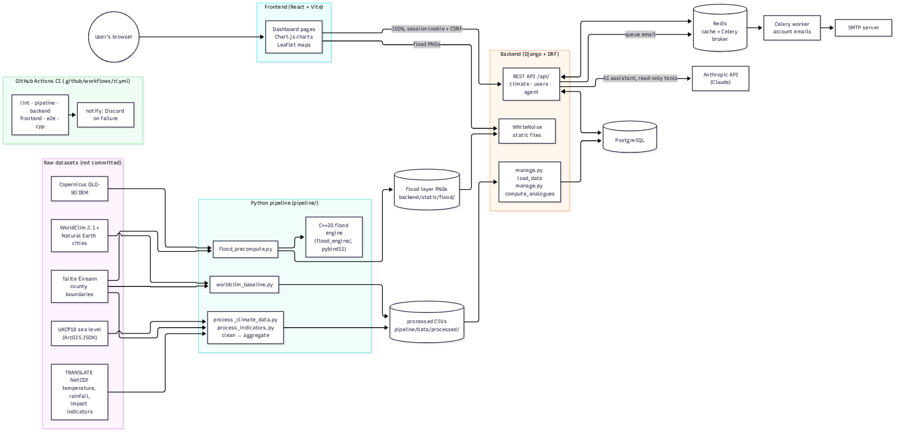

# Architecture

| Layer | Tech | Responsibility |
|---|---|---|
| Data pipeline | Python, Pandas, Xarray, GeoPandas | Process EPA NetCDF/CSV, aggregate to counties, load PostgreSQL |
| Database | PostgreSQL | County projections, sea level, users, email links |
| API | Django + DRF | REST endpoints, session auth with CSRF, profile and avatars, email links ([api.md](api.md#accounts-ccd-294-ccd-427-ccd-441)) |
| AI assistant | Anthropic API (Claude Haiku 5.5), `anthropic` SDK tool runner | `/api/agent/chat/`: answers questions from the database through three read-only tools and streams the answer ([api.md](api.md#ai-assistant-ccd-347)) |
| Static files | WhiteNoise | Serves `/static/` (admin, Swagger, flood map PNGs) from Django itself, also with `DEBUG` off. `collectstatic` runs when the backend container starts, so the host needs no static file setup |
| Background jobs | Celery worker + Redis | Sends account and report emails outside the request (`worker` service in `docker-compose.yml`) |
| Cache | Redis | `/meta/` and `/map/` responses and rate-limit counters ([api.md](api.md#rate-limits-ccd-351)); optional |
| Frontend | React + Chart.js | Dashboard, charts, scenario comparison |
| CI | GitHub Actions | Tests and build on every pull request |
| Flood engine | C++20, pybind11, CMake | `flood_engine/`: computes which cells flood at each sea level from the Copernicus DEM. Run offline by `pipeline/flood_precompute.py`, which writes PNG layers to `backend/static/flood/` for the 15 coastal counties ([flood-engine.md](flood-engine.md)) |
| Maps | Leaflet, react-leaflet | `MapView.jsx` (all counties on one map) and `FloodMap.jsx` (flood layers, which are the precomputed PNGs) |
| Climate analogues | WorldClim 2.1, Natural Earth, `manage.py compute_analogues` | European cities whose present climate is closest to a county's projected climate, stored in CityClimate and CountyAnalogue ([climate-analogues.md](climate-analogues.md)) |
| CI jobs and alerts | GitHub Actions (`ci.yml`), Discord webhook | Jobs `lint`, `pipeline`, `backend`, `frontend`, `e2e`, `cpp`; `notify` posts to the team Discord when any of them fails |

## Request flow

1. User selects a county in React.
2. React calls `GET /api/counties/<slug>/`.
3. Django queries PostgreSQL and returns JSON (values, units, scenario, period, baseline).
4. React renders the charts and commentary.

## Diagram (CCD-254)

Source: [architecture-diagram.mmd](architecture-diagram.mmd). Edit the `.mmd` and re-export with `npx -y @mermaid-js/mermaid-cli -i docs/architecture-diagram.mmd -o docs/architecture-diagram.png -b white -s 2`. How the data steps work: [pipeline.md](pipeline.md).
