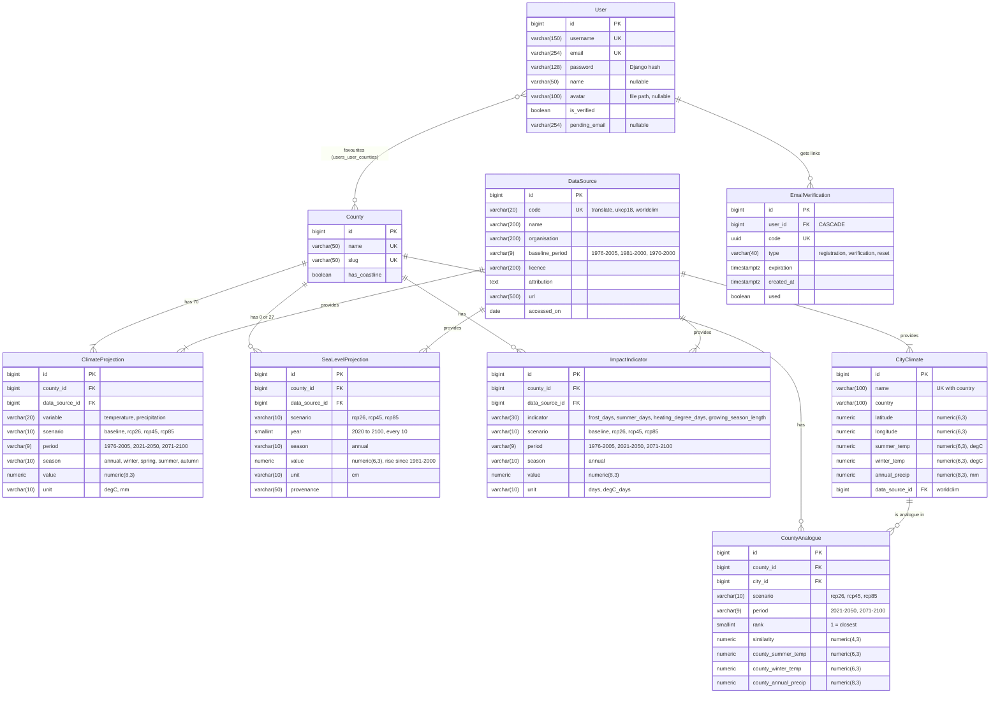

# Data model (CCD-33)

The final database model. This page is the summary. Every attribute's unit, allowed values and CSV source, plus the reasoning behind each choice, are in [entities.md](entities.md). Keep the two files in step: change both in the same pull request.

PostgreSQL. In the climate tables no column allows NULL and every foreign key is `PROTECT`. The account tables (User, EmailVerification) are the exception, see [User and EmailVerification](#user-and-emailverification-sprint-3).

## ER diagram

Source: [er-diagram.mmd](er-diagram.mmd) · image: [er-diagram.png](er-diagram.png). Edit the `.mmd`, paste it here, and re-export the PNG with `npx -y @mermaid-js/mermaid-cli -i docs/er-diagram.mmd -o docs/er-diagram.png -b white -s 3` (`-s 3` renders at 3× so the ten tables stay readable).

Only the project's own tables are drawn. Framework tables (not drawn): Django's `auth_group`, `auth_permission`, `users_user_groups`, `users_user_user_permissions`, `django_admin_log`, `django_content_type`, `django_session`, `django_migrations`, and `django_celery_results_*` from Celery.

Favourite counties (CCD-442) are not a separate model: they are the many-to-many field `User.counties`, stored in Django's join table `users_user_counties` (see [Relationships](#relationships)).

## County
| Field | Type | Null | Notes |
|---|---|---|---|
| id | bigint PK | no | |
| name | varchar(50), unique | no | e.g. `Cork`. The 26 ROI counties, from `climate_data.csv.county` |
| slug | varchar(50), unique | no | e.g. `cork`. Lower case, spaces → `-` |
| has_coastline | boolean | no | `true` for the 15 counties in `sea_level.csv` |

## ClimateProjection
| Field | Type | Null | Notes |
|---|---|---|---|
| id | bigint PK | no | |
| county_id | bigint FK → County | no | PROTECT |
| data_source_id | bigint FK → DataSource | no | PROTECT. Always `translate` |
| variable | varchar(20) | no | `temperature`, `precipitation` |
| scenario | varchar(10) | no | `baseline`, `rcp26`, `rcp45`, `rcp85` |
| period | varchar(9) | no | `1976-2005` (baseline only), `2021-2050`, `2071-2100` |
| season | varchar(10) | no | `annual`, `winter`, `spring`, `summer`, `autumn` |
| value | numeric(8,3) | no | Absolute value for the period, in `unit` |
| unit | varchar(10) | no | `degC` (temperature), `mm` (precipitation) |

1,820 rows. Change from baseline is calculated in the API.

## SeaLevelProjection
| Field | Type | Null | Notes |
|---|---|---|---|
| id | bigint PK | no | |
| county_id | bigint FK → County | no | PROTECT. Coastal counties only |
| data_source_id | bigint FK → DataSource | no | PROTECT. Always `ukcp18` |
| scenario | varchar(10) | no | `rcp26`, `rcp45`, `rcp85` |
| year | smallint | no | 2020, 2030 … 2100 |
| season | varchar(10) | no | Always `annual` |
| value | numeric(6,3) | no | Rise since the 1981–2000 mean, from `rise_cm` |
| unit | varchar(10) | no | Always `cm` |
| provenance | varchar(50) | no | `UKCP18`, or `UKCP18, estimated from Sligo` / `… from Clare` |

405 rows (15 coastal counties × 3 scenarios × 9 years). Inland counties have no rows.

## ImpactIndicator
Added by Taras (CCD-364, CCD-367, CCD-368). Loaded by `load_data` from `impact_indicators.csv` (contract CCD-366) and served by `GET /counties/{slug}/impacts/` ([api-examples.md](api-examples.md)).

| Field | Type | Null | Notes |
|---|---|---|---|
| id | bigint PK | no | |
| county_id | bigint FK → County | no | PROTECT |
| data_source_id | bigint FK → DataSource | no | PROTECT. Always `translate` |
| indicator | varchar(30) | no | `frost_days`, `summer_days`, `heating_degree_days`, `growing_season_length` |
| scenario | varchar(10) | no | `baseline`, `rcp26`, `rcp45`, `rcp85` |
| period | varchar(9) | no | `1976-2005` (baseline), `2021-2050`, `2071-2100` |
| season | varchar(10) | no | Always `annual` (the CSV has no season column) |
| value | numeric(8,3) | no | Absolute value for the period, in `unit` |
| unit | varchar(10) | no | `degC_days` for `heating_degree_days`, `days` for the other three |

28 rows per county in the Cork example in api-examples.md (4 indicators × 7 scenario-period pairs). Change from baseline is calculated in the API, as for ClimateProjection.

## DataSource
| Field | Type | Null | Notes |
|---|---|---|---|
| id | bigint PK | no | |
| code | varchar(20), unique | no | `translate`, `ukcp18`, `worldclim` |
| name | varchar(200) | no | |
| organisation | varchar(200) | no | |
| baseline_period | varchar(9) | no | `1976-2005` (translate), `1981-2000` (ukcp18), `1970-2000` (worldclim) |
| licence | varchar(200) | no | |
| attribution | text | no | Footer line from DATA_SOURCES.md |
| url | varchar(500) | no | |
| accessed_on | date | no | |

3 rows: `translate` and `ukcp18` from the `data_sources` fixture (copied from [DATA_SOURCES.md](../DATA_SOURCES.md)), `worldclim` from the `worldclim_source` fixture. A projection's baseline period is found through this table.

## Relationships

| Parent | Child | Cardinality |
|---|---|---|
| County | ClimateProjection | 1–N (70 per county) |
| County | SeaLevelProjection | 1–N, where N can be 0 (27 per coastal county, 0 inland) |
| DataSource | ClimateProjection | 1–N |
| DataSource | SeaLevelProjection | 1–N |
| County | ImpactIndicator | 1–N |
| DataSource | ImpactIndicator | 1–N |
| DataSource | CityClimate | 1–N |
| County | CountyAnalogue | 1–N, where N can be 0 (before `compute_analogues` is run) |
| CityClimate | CountyAnalogue | 1–N, where N can be 0 (a city that is never among the closest) |
| User | EmailVerification | 1–N, where N can be 0 (one row per email link sent) |
| User | County | N–N, both sides can be 0: a user's favourite counties (`User.counties`, reverse name `favourited_by`). Join table `users_user_counties` (`id` bigint, `user_id`, `county_id`), one row per user and county |

Sea level is stored per county because UKCP18 (adopted in CCD-19, 27 Oct 2026) gives values for coastal locations. Inland counties show "No coastline", never 0.

## Constraints

Unique:
- County (`name`), County (`slug`), DataSource (`code`), User (`username`), User (`email`), EmailVerification (`code`), users_user_counties (`user_id`, `county_id`)
- ClimateProjection (`county_id`, `variable`, `scenario`, `period`, `season`)
- SeaLevelProjection (`county_id`, `scenario`, `year`)
- ImpactIndicator (`county_id`, `indicator`, `scenario`, `period`)
- CityClimate (`name`, `country`)
- CountyAnalogue (`county_id`, `scenario`, `period`, `rank`) and (`county_id`, `scenario`, `period`, `city_id`)

Check (in the database):
- CountyAnalogue: `scenario` ≠ `baseline` (`analogue_not_baseline`); `rank` ≥ 1 (`analogue_rank_from_1`)

Enforced by Django and the loader, not by database CHECK constraints (the columns use Django `choices` and validators, which run in the app, and `load_data` rejects bad rows):
- ClimateProjection: `variable`, `scenario`, `period` and `season` are each in their allowed set (above)
- ClimateProjection: (`scenario` = `baseline`) = (`period` = `1976-2005`)
- ClimateProjection: (`variable`, `unit`) is (`temperature`, `degC`) or (`precipitation`, `mm`)
- SeaLevelProjection: `scenario` in (`rcp26`, `rcp45`, `rcp85`); `year` between 2020 and 2100 and a multiple of 10; `season` = `annual`; `unit` = `cm`
- ImpactIndicator: each `indicator` has one `unit`; `season` = `annual`

Also enforced by the loader, not the database: sea level rows only for counties with `has_coastline = true`. Value ranges are validation checks (CCD-239), not constraints. The bad row each rule rejects is listed in [entities.md §10](entities.md#10-relationships-and-rules).

## Delete rules

Every foreign key of the climate tables is `on_delete=PROTECT` (RESTRICT). A County or DataSource can't be deleted while projections refer to it. Data changes come from re-running the loader (`update_or_create`), never from deleting parents, so a cascade could only cause silent data loss.

The account tables use `CASCADE`. EmailVerification → User: deleting an account also deletes its email links, which are useless without the user. `users_user_counties` → User and → County (Django's default for a many-to-many join table): deleting an account removes its favourites. Deleting a County would also remove its favourite rows, but counties can't be deleted while projections refer to them (PROTECT above).

## Conventions

- **Season** is stored lower case (`annual`, `winter`, …), matching the API keys. The loader converts the CSV's `Annual`.
- **Unit codes** are stored as the CSV has them: `degC`, `mm`, `cm`, and for impact indicators `days`, `degC_days`. The API shows `degC` as `°C`.
- **Scenario codes**: `baseline`, `rcp26`, `rcp45`, `rcp85`. The API adds the labels (`RCP2.6` …).
- **Absolute values only** for temperature and precipitation. Sea level is already a change from its baseline.
- **No NULLs.** "Not applicable" is a constant or a missing row.

## User and EmailVerification (Sprint 3)

**User** (`users.User`, CCD-294, CCD-427) extends Django's `AbstractUser` (hashed passwords; `is_active`, `is_staff`, `date_joined` and the other built-in columns are not shown above). It drops `first_name` and `last_name` and adds:

- `email`: unique, stored lower case; sign-in works with the username or the email.
- `name`: display name, optional.
- `avatar`: path of the picture in `media/users/`, optional (rules in [api.md](api.md#avatars)).
- `is_verified`: set once the user opens the link from the registration email.
- `pending_email`: a requested new email, moved into `email` only when the link sent to it is opened (CCD-431).

`email_reports` is not in the model yet (CCD-319). Saved counties are `counties`, a many-to-many field to County (CCD-442, see [Relationships](#relationships)).

**EmailVerification** (CCD-441) is one row per link sent by email: a one-time UUID `code`, the `type` (`registration`, `verification` for an email change, `reset` for a password reset), an `expiration` one hour after it is sent, and a `used` flag. The link flow is described in [api.md](api.md#links-sent-by-email).

## CityClimate and CountyAnalogue (Sprint 3, CCD-356)

For the climate analogues (CCD-354): the European cities whose present climate is closest to a county's projected climate. Filled by `manage.py compute_analogues` (CCD-357) from `pipeline/data/processed/worldclim_cities.csv` and `worldclim_counties.csv`; served by `GET /counties/{slug}/analogues/` ([api-examples.md](api-examples.md)).

**CityClimate**: one row per city, present-day climate from WorldClim 2.1 (1970–2000).

| Field | Type | Null | Notes |
|---|---|---|---|
| id | bigint PK | no | |
| name | varchar(100) | no | e.g. `Brest` |
| country | varchar(100) | no | e.g. `France`. Unique with `name` |
| latitude, longitude | numeric(6,3) | no | From Natural Earth |
| summer_temp | numeric(6,3) | no | Mean of June–August, °C |
| winter_temp | numeric(6,3) | no | Mean of December–February, °C |
| annual_precip | numeric(8,3) | no | Total of the 12 months, mm |
| data_source_id | FK → DataSource | no | PROTECT. Always `worldclim` (its `baseline_period` is `1970-2000`) |

**CountyAnalogue**: the closest cities for one county, scenario and period, rank 1 = closest.

| Field | Type | Null | Notes |
|---|---|---|---|
| id | bigint PK | no | |
| county_id | FK → County | no | PROTECT |
| city_id | FK → CityClimate | no | PROTECT |
| scenario | varchar(10) | no | `rcp26`, `rcp45`, `rcp85` (not `baseline`) |
| period | varchar(9) | no | `2021-2050`, `2071-2100` |
| rank | smallint | no | 1, 2, 3 |
| similarity | numeric(4,3) | no | 1 / (1 + distance), 0 to 1, higher is closer |
| county_summer_temp, county_winter_temp, county_annual_precip | numeric | no | The county's projected climate the cities were compared with: WorldClim value + TRANSLATE change from 1976–2005 |

Constraints: unique (`county_id`, `scenario`, `period`, `rank`) and (`county_id`, `scenario`, `period`, `city_id`), so a city is listed once per county, scenario and period; check `scenario` ≠ `baseline`; check `rank` ≥ 1. Re-running the command replaces a county's rows, so nothing is deleted by hand.

## Changes from the draft
- Sea level is **per county** instead of national (SeaLevelProjection now has `county_id`).
- `rise_m` (metres) → `rise_cm` from the CSV, stored as `value` with `unit` = `cm`.
- Sea level years **2050 / 2100 → every decade from 2020 to 2100** (9 years).
- **DataSource** table added. It holds the baseline period, licence and attribution. The draft's free-text `source` became `provenance`.
- ClimateProjection `unit` is loaded from the CSV as `degC`, not derived as `°C`.
- County gains `has_coastline`. All columns are NOT NULL, and every FK is PROTECT.

Schema audit, Sprint 3 (CCD-255): checked against every `models.py` and migration on `main`; `makemigrations --check --dry-run` reports "No changes detected".
- **ImpactIndicator** added to the diagram, field tables, relationships and constraints. Reason: the table exists (migration `climate 0003`), but it was not documented.
- **CityClimate and CountyAnalogue** added to the diagram and relationships. Reason: they were in a section of their own but missing from the ER diagram (migration `climate 0005`).
- **IDs and FKs are `bigint`**, not `integer`. Reason: every model uses Django's `BigAutoField` (see the migrations).
- **The CHECK list is split** into what the database enforces (CountyAnalogue only) and what Django and the loader enforce. Reason: no migration creates CHECK constraints on ClimateProjection or SeaLevelProjection, so the earlier list overstated the database rules.
- **DataSource** has 3 rows, adding `worldclim` (1970–2000). **Unit codes** add `days` and `degC_days` (migration `climate 0004`).
- **Framework tables** are listed but not drawn, so the diagram stays about the project's data.
- **Favourite counties** (CCD-442, migration `users 0005`) added as the User N–N County relationship. Reason: the planned FavouriteCounty model was built as a many-to-many field (`User.counties`) instead, so the table is Django's join table `users_user_counties`, not a model of its own.
