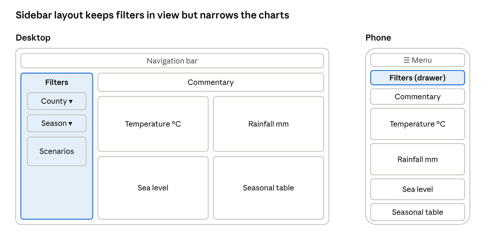
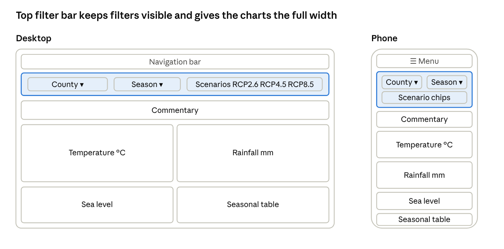
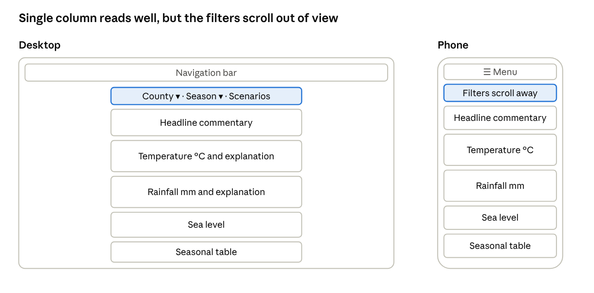
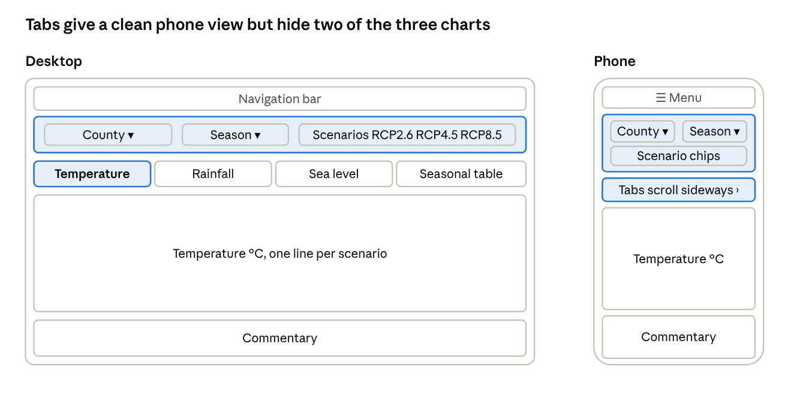

# CCD-68: Research Website Layouts

Oct 27, 2026 · @Ronel

## Summary (CCD-110)

Use a top navigation bar with separate pages. In the wireframes (CCD-69) a visitor chooses a county on its own page, and the county dashboard opens with a filter panel (scenario, period, season) above full-width sections for temperature, rainfall and sea level. Each section has a chart and a summary panel, and the seasonal table and commentary follow. On phones the sections stack and the filter panel collapses and stays in view as the page scrolls. This gives the charts the full page width, it takes three clicks from the homepage to reach a county dashboard and one to switch a scenario, and every chart can carry the unit, scenario, period, baseline and source that the data-flow display rules require. Sea level has its own baseline and time axis, so it gets its own caption. A Climate analogue page sits alongside the dashboard. Sidebar, single-column story and tabbed layouts were sketched and rejected for the reasons in the layout comparison.

## Sites reviewed (CCD-71)

Four comparable climate projection tools were reviewed on 30 October 2026. Screenshots could not be taken from this session, and the notes below come from articles and guides that describe each tool rather than from using it, so add a screenshot for each site and check the notes against the live pages. The Met Office UKCP18 interface could not be opened and is not included.

| Site and URL                                                                                                                                                                                                                                                              | Date read   | What is clear                                                                                                                                                              | What is confusing                                                                                                                                                                                     | Units and scenario labels                                                                                                                               |
|---------------------------------------------------------------------------------------------------------------------------------------------------------------------------------------------------------------------------------------------------------------------------|-------------|----------------------------------------------------------------------------------------------------------------------------------------------------------------------------|-------------------------------------------------------------------------------------------------------------------------------------------------------------------------------------------------------|---------------------------------------------------------------------------------------------------------------------------------------------------------|
| [Copernicus Interactive Climate Atlas](https://climate.copernicus.eu/copernicus-interactive-climate-atlas-guide-powerful-new-c3s-tool) (guide page)                                                                                                                       | 30 Oct 2026 | Map-first layout with a top-left dataset menu and sidebar tools; time series, climate stripes and a summary table; downloads as CSV, PNG or PDF; tooltips and a user guide | The page itself says users need context: change versus absolute values, uncertainty shown as shaded percentiles, streaky maps where trends are not significant, and model choices that change results | Scenarios named by RCP or SSP and by warming level; the page does not state units, so they must be checked in each output                               |
| [Met Éireann TRANSLATE county graphics](https://www.irishtimes.com/environment/climate-crisis/2024/08/16/ireland-climate-change-interactive-graphics-global-warming-how-will-ireland-my-county-area-be-affected-by-climate-change-met-eireann) (Irish Times, 16 Aug 2024) | 30 Oct 2026 | County chosen by clicking a map or using a search bar; the page reads as a story, from current climate to a county map at the end                                          | The article says the graphics are best viewed on desktop; the unit of the temperature change figure is not stated in the text                                                                         | Future values are changes from a 1976 to 2005 baseline at warming levels of 1.5 to 4 degrees, with a 10th to 90th percentile range; precipitation in mm |
| [NOAA Climate Explorer](https://www.climate.gov/news-features/feed/updated-climate-explorer-now-offers-projections-entire-united-states) (climate.gov, 12 Oct 2021)                                                                                                       | 30 Oct 2026 | Click a county on the map; past and projected conditions for two scenarios side by side; graph values update under the cursor; downloadable tables                         | The article does not name the scenarios or variables; the page notes Climate.gov content has not been updated since 25 June 2025, so the tool may have changed                                        | Projections labelled as decadal averages, not annual values; scenario names not given in the article                                                    |
| [Climate Ireland (EPA)](https://climate-adapt.eea.europa.eu/en/navigator/tool-catalogue/climate-ireland-adaptation-strategy-explorer) (catalogue entry; tool at https://www.climateireland.ie/)                                                                           | 30 Oct 2026 | One place for projections, risk guidance and adaptation plans, with maps, graphs and indicators on a roughly 1.5 km grid                                                   | Aimed mainly at adaptation practitioners, and the entry says some material is technical for users without experience                                                                                  | Not described in the entry; the tool itself could not be opened from this session                                                                       |

What these sites suggest for our design:

- **Choosing a county:** the three tools with a map (Copernicus, Met Éireann, NOAA) let users click an area. The wireframes use a search box and an A to Z list of the 26 counties on their own page, with a clickable map kept as a later idea.

- **Naming scenarios:** Met Éireann uses warming levels and Copernicus names both pathways and warming levels. Our data uses RCP2.6, RCP4.5 and RCP8.5, so label each with low, moderate or high emissions, as the wireframes do.

- **Showing change from a baseline:** Met Éireann also uses 1976 to 2005 as its baseline, which matches ours, so the baseline should be stated on every chart.

- **Uncertainty:** Met Éireann and Copernicus show a range or shaded band. Our values are ensemble means with no spread, which the data-flow limitations already say must be stated in the report.

- **Phones:** one of the four sites says its graphics work best on desktop, so a phone-friendly layout is a gap we can fill.

Sources: the four linked pages, each read on 30 October 2026.

## Layout options (CCD-70, CCD-109)

Four layout patterns are compared using the dashboard's real content from the data-flow document and the frontend README: a county selector (26 counties), a season switch (annual plus four seasons), a scenario filter (RCP2.6, RCP4.5 and RCP8.5, one line each), temperature and rainfall charts, a seasonal table, commentary, and a sea-level chart. Sea level has its own baseline (1981 to 2000 in the wireframes) and its own time axis, so the season and period filters do not apply to it. Phone behaviour was judged from the sketches and from layout guidance, not tested on devices.

Guidance used: a top bar suits a few global filters and a left sidebar suits several filter groups, filters that change the whole page should stay visible, and phones should use a single column ([Kinda Technical](https://kindatechnical.com/data-visualization/dashboard-layout-best-practices-and-design-patterns.html)). Filters also take scarce space on a phone, so a mobile view should keep few of them ([iccube](https://www.iccube.com/post/7-things-to-think-about-desktop-vs-mobile-dashboards)).

### A. Sidebar filters with chart grid

The county selector, season switch and scenario chips sit in a left sidebar that stays visible, with the commentary and a two-column grid of chart cards beside it. On a phone the sidebar becomes a Filters button that opens a drawer, and the cards stack in one column.

A. Sidebar filters with chart grid, desktop and phone

Left is the desktop view; right is the phone view, where the sidebar becomes a Filters drawer.

### B. Top filter bar with chart cards

A filter bar under the navigation holds the county selector, season switch and scenario chips. Below it come the commentary, then temperature and rainfall side by side, then sea level and the seasonal table. On a phone the bar shrinks to two selects and a row of chips, and the cards stack.

B. Top filter bar with chart cards, desktop and phone

The filter bar holds all three controls on one row; on a phone it condenses to two selects and a row of scenario chips.

### C. Single-column story

One narrow column reads from top to bottom: the county selector and headline commentary, then temperature, rainfall, sea level and the seasonal table, each with a sentence of explanation. A phone shows the same column, but the filters scroll out of view unless they are made sticky.

C. Single-column story, desktop and phone

The column is the same on both screens, so there is little to adapt, but the filters leave the screen as the reader scrolls.

### D. Tabbed sections

A filter bar sits at the top, and tabs (Temperature, Rainfall, Sea level, Seasonal table) show one section at a time. On a phone the tabs scroll sideways and only one chart is on screen.

D. Tabbed sections, desktop and phone

Only the selected tab is on screen, so temperature and rainfall can never be seen together.

### Comparison

| Layout                      | Pros                                                                                                  | Cons                                                                                                                                                                          | At phone width                                                                            | Verdict                                                                 |
|-----------------------------|-------------------------------------------------------------------------------------------------------|-------------------------------------------------------------------------------------------------------------------------------------------------------------------------------|-------------------------------------------------------------------------------------------|-------------------------------------------------------------------------|
| A. Sidebar and grid         | Filters always visible and grouped; room to add filters later                                         | The sidebar takes about a quarter of the width, so charts get narrower; three controls do not need a sidebar                                                                  | Filters move behind a button, so the active county is no longer visible; cards stack well | Rejected                                                                |
| B. Top filter bar and cards | Filters stay visible on one row; charts use the full width; temperature and rainfall sit side by side | The bar uses vertical space on phones and needs to be sticky to stay in view                                                                                                  | The bar condenses to two selects and chips; cards stack in one column                     | Recommended                                                             |
| C. Single-column story      | Simple to build and read; commentary leads; unchanged on phones                                       | Long scroll; filters scroll away; comparing temperature with rainfall means scrolling                                                                                         | Nothing to adapt                                                                          | Rejected as the main layout, but its commentary-first order is borrowed |
| D. Tabbed sections          | Clean phone view with one chart at a time; no long page                                               | Hides charts behind clicks (two more clicks to see all three); temperature and rainfall cannot be compared side by side; tabs need careful keyboard and screen reader support | Tabs scroll sideways; one chart per screen                                                | Rejected                                                                |

Note: the layout B sketch shows a county dropdown in the filter bar and temperature and rainfall side by side. The wireframes (CCD-69) changed both: the county is chosen on its own page, and the sections are stacked. See Recommendation.

Sources: [Dashboard layout best practices (Kinda Technical)](https://kindatechnical.com/data-visualization/dashboard-layout-best-practices-and-design-patterns.html), [Desktop vs mobile dashboards (iccube)](https://www.iccube.com/post/7-things-to-think-about-desktop-vs-mobile-dashboards), and the team's data-flow.md and frontend README.

## Navigation options (CCD-108)

Three navigation approaches were compared by counting clicks from the homepage. A county dropdown counts as 2 clicks (open it, choose a county), a scenario chip counts as 1, and a phone's menu button adds 1 whenever a page link is needed. The counts come from the proposed flows, not from testing with users. The wireframes use a county list page instead of a dropdown, so their flow is one click longer than the count for the recommended approach below.

| Approach                                                                                                                 | Clicks to reach a county dashboard                     | Clicks to switch scenario                                                                                        | Pros                                                                            | Cons                                                                                                                        | Verdict     |
|--------------------------------------------------------------------------------------------------------------------------|--------------------------------------------------------|------------------------------------------------------------------------------------------------------------------|---------------------------------------------------------------------------------|-----------------------------------------------------------------------------------------------------------------------------|-------------|
| Top navigation bar with separate pages (Home, Choose a county, Climate analogue, Sign in); county chosen on its own page | 2 in the research flow; 3 in the wireframes (phone: 3) | 1 with a scenario chip on the dashboard, including Compare all (phone: 1, or 2 if the filter panel is collapsed) | Four or five pages fit on one row; charts keep the full width; one page per job | A phone needs a menu button for page links                                                                                  | Recommended |
| Sidebar with separate pages                                                                                              | 3: the Dashboard link, then the picker (phone: 4)      | 1 with a scenario chip; 1 to open the Compare page (phone: 2)                                                    | Room for many pages; always shows where you are                                 | Only four or five pages, so most of the sidebar is empty; it takes width from the charts; one extra click to reach a county | Rejected    |
| Tabs on one page (Temperature, Rainfall, Sea level, Compare)                                                             | 2                                                      | 1 with a scenario chip; 1 to open the Compare tab                                                                | No page changes; the selected county stays in place                             | Two more clicks to see all three charts; Login still needs its own page                                                     | Rejected    |

Recommendation: use the top navigation bar with separate pages. In the wireframes it reaches a county dashboard in three clicks (the homepage button, a county, then View dashboard; two if tapping a county opens its dashboard directly), keeps the charts at full width, and suits a short list of pages. Put the county in the page address (for example /county/cork) so the choice survives moving between pages.

Sources: the author's analysis of the flows above, and filter and navigation placement guidance from [Kinda Technical](https://kindatechnical.com/data-visualization/dashboard-layout-best-practices-and-design-patterns.html).

## Recommendation

Build layout B as refined in the wireframes (CCD-69, a draft for team review in CCD-77; the meeting notes with the agreed layout direction were not available, so check against them): a top navigation bar, a county selection page, and a county dashboard with a filter panel above full-width stacked sections. The wireframes cover four screens, each at desktop and phone width.

1.  **Navigation bar:** Home, Choose a county, Climate analogue and Sign in, with a menu button on phones. Data sources, About and Contact are in the footer.

2.  **County selection page:** a search box and an A to Z list of the 26 counties, a 'coast' tag on the 15 coastal counties, and a selected-county panel with a View dashboard button. There is a 'No county found' state. On phones it is a one-column list with a sticky View dashboard bar.

3.  **Filter panel:** scenario (RCP2.6, RCP4.5 and RCP8.5, each labelled low, moderate or high emissions, plus Compare all), period (2021 to 2050 or 2071 to 2100) and season (annual, winter, spring, summer, autumn). The county is not a filter: it is chosen on its own page, with a Change county link on the dashboard.

4.  **Commentary last:** the API's commentary sits in an 'In plain language' block after the seasonal table, labelled 'Generated commentary' and shown as the API returns it. The research sketch put it first; the wireframes moved it down.

5.  **Temperature and rainfall as stacked sections:** four summary cards sit above them (present-day temperature and rainfall, projected temperature change, sea level rise). Each section has a full-width chart with one line per scenario and a summary panel beside it, which stacks below the chart on phones. Every chart and number shows the unit, scenario, period, baseline and source, as the data-flow display rules require.

6.  **Sea level:** its own caption and baseline (1981 to 2000, against 1976 to 2005 for temperature and rainfall), a chart from 2020 to 2100, and no response to the season or period filters. Inland counties show a 'No coastline' panel, never 0. Leitrim and Limerick show a note that values are estimated from Sligo and Clare.

7.  **Seasonal table:** winter to autumn changes for 2071 to 2100 against 1976 to 2005, with values taken from the API. The wireframes show placeholders, and on phones the table scrolls sideways inside a box.

8.  **On phones:** the sections stack in one column, the filter panel is collapsible and sticky on scroll, and the page links move behind the menu button.

9.  **Climate analogue page:** reached from a link at the foot of the dashboard. It has county, scenario and period selects, a headline sentence, the county's projected values beside the analogue's present-day values (baseline 1976 to 2005), and a similarity word, bar and the real differences. When no analogue exists it shows a 'No close analogue available' state with alternatives: try RCP4.5, try 2021 to 2050, or go back to the dashboard.

Open questions for the team:

- Should a scenario chip hide or show a line, or switch the charts to a single scenario? The wireframes show all three lines with RCP4.5 selected and use the chosen scenario for the summary cards, so this needs confirming.

- Is sea level per coastal county or national? The data-flow document describes a national endpoint with the source still undecided (risk R12), while the wireframes show values for 15 coastal counties, with Leitrim and Limerick estimated from Sligo and Clare.

- Do we add a clickable county map later, as three of the four sites reviewed have? The wireframes show it as an optional stretch idea, because the React research marks maps out of scope.

- Is the stacked layout intended? Sketch B put temperature and rainfall side by side, but the wireframes stack them, which makes them harder to compare without scrolling (a con the comparison gave layout C).

- Does tapping a county open its dashboard, or select it first and then use View dashboard? The wireframe text says both.

- Which pool does the climate analogue use? County baselines are 8.7 to 9.9 °C but end-century projections are 11 to 12.5 °C, so no Irish county matches today. Decide whether the pool includes places outside Ireland and what difference counts as 'no analogue'. There is no analogue data or endpoint in the repo yet.

- Is the commentary 'AI commentary' (as ticket CCD-74 says) or the API's commentary array shown as returned (as the data-flow document says)? The label has to be honest.

## Presenting to the team (CCD-111)

A suggested 8-minute run for the team meeting:

1.  **The need (1 minute):** the dashboard must show projections clearly to a public audience, keep units and scenarios readable, and work on phones.

2.  **What other sites do (1 minute):** three of the four reviewed let users click a map, one says it works best on desktop, and they name scenarios differently.

3.  **Four layouts (2 minutes):** walk through the sketches and the comparison table.

4.  **Recommendation and navigation (2 minutes):** layout B with a top navigation bar, then the four wireframed screens (homepage, county selection, dashboard, climate analogue), with three clicks to a county dashboard and one to switch scenario.

5.  **Questions and objections (2 minutes or more):** use the open questions under Recommendation.

Likely objections, and the answer from this research:

- **"Why not a map to pick the county?"** A searchable A to Z list is accessible and simple, and a map is kept as a later idea.

- **"Tabs are cleaner on a phone."** They hide two of the three charts and need two more clicks to see them all.

- **"A sidebar is the usual dashboard pattern."** With three filters it narrows the charts for little gain.

After the meeting:

- [ ] Present the layout and navigation recommendation (5 to 10 minutes)

- [ ] Collect questions and objections

- [ ] Record the agreed direction and any changes in the meeting notes

## Sources

All pages were read on 30 October 2026.

- [Copernicus Interactive Climate Atlas guide](https://climate.copernicus.eu/copernicus-interactive-climate-atlas-guide-powerful-new-c3s-tool)

- [Met Éireann TRANSLATE county graphics, Irish Times, 16 Aug 2024](https://www.irishtimes.com/environment/climate-crisis/2024/08/16/ireland-climate-change-interactive-graphics-global-warming-how-will-ireland-my-county-area-be-affected-by-climate-change-met-eireann)

- [Updated Climate Explorer, climate.gov, 12 Oct 2021](https://www.climate.gov/news-features/feed/updated-climate-explorer-now-offers-projections-entire-united-states)

- [Climate Ireland Adaptation Strategy Explorer, Climate-ADAPT catalogue entry](https://climate-adapt.eea.europa.eu/en/navigator/tool-catalogue/climate-ireland-adaptation-strategy-explorer)

- [Dashboard layout best practices and design patterns (Kinda Technical)](https://kindatechnical.com/data-visualization/dashboard-layout-best-practices-and-design-patterns.html)

- [7 things to think about: desktop vs mobile dashboards (iccube)](https://www.iccube.com/post/7-things-to-think-about-desktop-vs-mobile-dashboards)

- Team files: data-flow.md, the frontend README.md and the wireframes README (CCD-69)

Not opened: the Met Office UKCP18 interface, the USGS paper on communicating future climate on the web, and the live Climate Ireland, NOAA and Copernicus tools. Several of these were blocked from this session.
